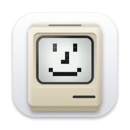
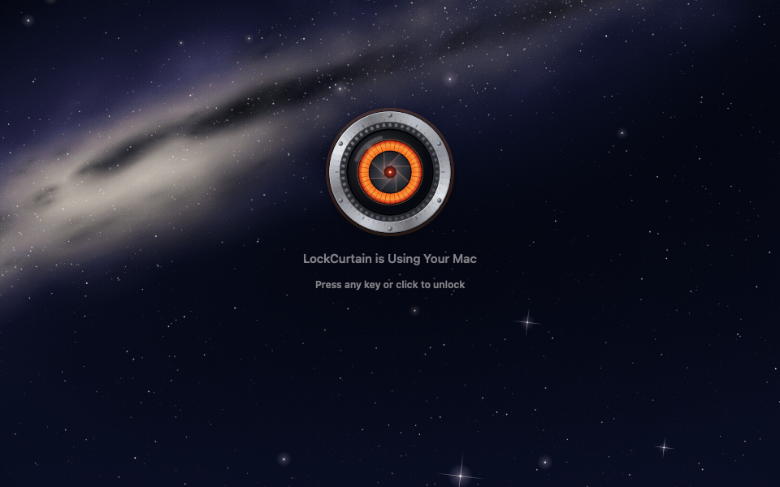

<p align="center"></p>

<h1 align="center">LockCurtain</h1>

<p align="center">Step away while your AI agent keeps working. Anyone walking by sees only a curtain.</p>

<p align="center">English · <a href="README.zh-CN.md">中文</a></p>

<p align="center"></p>

When Claude Code, Codex or another agent is running a long task and you need to step away, you face a choice.
Lock the screen, and screenshots and simulated clicks may stop working. Leave it unlocked, and anyone passing by can see and touch your desktop.

LockCurtain's **away mode** doesn't lock the screen. It covers every display with a curtain instead:

- **The agent keeps working.** The curtain is invisible to screenshots and screen recording, so automation tools see the real desktop underneath. Keyboard and mouse input sent by programs goes through as usual.
- **People can't reach the desktop.** When someone presses a key or clicks, that input is swallowed and the computer locks. The curtain lifts only once the system lock screen is up.

Available for Mac and Windows.

## Features

- **Away mode.** Turn it on yourself, or let rules do it: idle for N minutes, an app or process is running, an app is keeping the computer awake, a time window, on AC power. Away mode starts when all enabled conditions are met, and keeps the computer awake.
- **Curtain styles.** Patterns: mechanical eye, demon eye, Taoist talisman, clock, vault door, padlock, or your own picture. Backgrounds: wallpaper, blurred wallpaper, black, or generated starfield, hills and carbon fiber. The two lines of text on the curtain can be changed too.
- **Lock screen curtain** (Mac only). The same curtain also covers the real lock screen.
- **Panel** (menu bar / notification area). What is keeping the computer awake right now, how long it slept in the last 24 hours, and "Keep awake": no curtain, just no sleep.
- **Command line.** `--send away` / `hide` / `status`, so agents and scripts can turn on away mode themselves. On the Mac you can also trigger it remotely from an iPhone Shortcut over SSH.
- **Automatic updates.** Checks once a day and asks before installing. No prompts or restarts while the curtain is up.

The interface is in Chinese only for now.

## Install

### Mac

Requires macOS 14 or later on Apple silicon.

1. Download `LockCurtain-<version>-mac.zip` from [Releases](https://github.com/Snowyyyyyy1/LockCurtain/releases/latest), unzip it and move LockCurtain to Applications.
2. macOS blocks the first launch because the app is signed with a self-made certificate and isn't notarized. Go to System Settings → Privacy & Security, scroll down to the LockCurtain entry and click "Open Anyway".
3. Grant two permissions. The Permissions page in LockCurtain's settings shows their status.
   - **Screen Recording** reads the current wallpaper for the curtain background.
   - **Accessibility** watches the keyboard and mouse to tell when someone is back. macOS doesn't prompt for it: click `+` in System Settings → Privacy & Security → Accessibility and add LockCurtain.

### Windows

Requires Windows 10 version 2004 or later (including Windows 11), 64-bit. So far tested only on Windows 11 ARM64. No separate .NET install needed.

1. Check Settings → System → About → System type. On an ARM-based processor (Snapdragon laptops, VMs on Apple silicon Macs), download `LockCurtain-<version>-win-arm64.zip`; otherwise download `-win-x64.zip`.
2. Unzip, right-click `install.ps1`, choose "Run with PowerShell" and accept the UAC prompt. It installs to `C:\Program Files\LockCurtain` and starts LockCurtain as administrator at every sign-in, without asking again.
   If that menu item is missing, open PowerShell in the unzipped folder and run `powershell -ExecutionPolicy Bypass -File .\install.ps1`.
3. The app isn't code-signed, so you may see "Windows protected your PC": click "More info", then "Run anyway". If Smart App Control is on, it blocks unsigned apps outright, and the only way around it is to turn it off in Windows Security.

Standard (non-admin) accounts can't use `install.ps1`. Keep the unzipped folder somewhere you own, run `LockCurtain.exe` and turn on "Open at login" in its settings.
In this mode, when a window running as administrator is in front, keystrokes reach that window first and the computer locks about 0.2 seconds later.

To uninstall, run `install.ps1 -Uninstall`. It removes the scheduled task and `C:\Program Files\LockCurtain`. Settings and logs stay in `%LOCALAPPDATA%\LockCurtain`; delete that folder if you don't need them.

Differences from the Mac version: the curtain can't cover the lock screen, and the Start menu and other system pop-ups appear above it.
"Last 24 hours" shows only sleep and wake, without per-app history of what kept the PC awake. There is no iPhone Shortcuts remote control, only the command line.

## Usage

Click the LockCurtain icon in the menu bar (the notification area on Windows) and choose 「进入离开模式」 (enter away mode). Then walk away.

When you come back, press any key or click once. The computer locks; unlock it with your password as usual. That keystroke or click never reaches the window the agent is working in.

To let an agent turn on away mode itself:

```bash
# Mac
/Applications/LockCurtain.app/Contents/MacOS/LockCurtain --send away
# Windows (PowerShell)
& "C:\Program Files\LockCurtain\LockCurtain.exe" --send away
```

`hide` lifts the curtain (in away mode it locks the computer first, like a human touch). `status` prints one line of JSON. Commands can only raise the curtain or lock the computer; there is no remote unlock.

Rules live on the 「规则」 (Rules) page in settings. A rule fires once, at the moment its conditions become true, so the curtain doesn't come right back after you dismiss it.

## FAQ

**Can the agent really take screenshots through the curtain?**
Yes. The curtain window uses `sharingType = .none` on the Mac and `WDA_EXCLUDEFROMCAPTURE` on Windows, so system screenshots and screen recording skip it.
On the Mac this was tested with ScreenCaptureKit, `screencapture` and cua-driver: all of them captured the desktop under the curtain, including windows opened after the curtain went up.

**Is this secure?**
The curtain is not a lock. In away mode your desktop is unlocked; the curtain protects against people walking by, who can't see the screen and lock it the moment they touch anything.
It doesn't protect against anyone who can run programs on the computer, such as someone logged in over SSH, or the agent itself.

**Will the computer sleep while I'm away?**
No. Away mode prevents system sleep and, by default, keeps the display on (you can turn that off in settings). Once the computer is really locked, LockCurtain stops preventing sleep. Closing a MacBook's lid still puts it to sleep.

**What if the curtain won't go away?**
On the Mac, if LockCurtain can't see the keyboard and mouse for 2 minutes (for example, because the Accessibility permission is missing), it locks the computer and lifts the curtain on its own.
If that fails too, log in from another device over SSH and run `pkill -9 -f LockCurtain`.

**Does it connect to the internet?**
Only for automatic updates: once a day it reads the update feed from GitHub. It collects no data. Builds from source don't check for updates.

## Build from source

Mac, with Xcode or the Command Line Tools:

```bash
git clone https://github.com/Snowyyyyyy1/LockCurtain.git
cd LockCurtain
./build.sh
open LockCurtain.app
```

Without a signing certificate the build is ad-hoc signed, and you have to grant permissions again after every rebuild. A self-made certificate avoids that: Keychain Access → Certificate Assistant → Create a Certificate, type "Code Signing", then `echo "<certificate name>" > .signing-cert`.

The Windows version is also built on a Mac: `brew install dotnet`, then run `windows/build.sh`.

Full usage, implementation notes and test records (in Chinese) are in [docs/guide.md](docs/guide.md).

## License

[AGPL-3.0](LICENSE)
